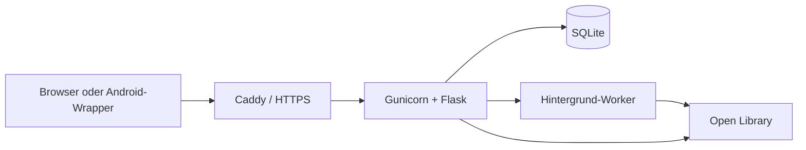

# Epiloguehouse – Architektur

## Überblick



Die Browser- und Android-Version verwenden dieselbe Flask-Weboberfläche und
dasselbe Backend. Capacitor stellt lediglich den nativen Android-Wrapper bereit.

## Komponenten

| Bereich | Technik | Aufgabe |
| --- | --- | --- |
| Backend | Flask | Seiten, Authentifizierung und JSON-API |
| Produktion | Gunicorn | WSGI-Server für Flask |
| Reverse Proxy | Caddy | Domain, HTTPS und Zertifikate |
| Datenbank | SQLite | Konten, Bibliotheken, Metadaten und Caches |
| Katalog | Open Library | Suche, Ausgaben, Cover und Reihen |
| Android | Capacitor | Native Hülle um die Web-App |
| Betrieb | Docker Compose | Entwicklung und Produktion |

## Umgebungen

### Entwicklung

`compose.yaml` startet den Flask-Entwicklungsserver auf `127.0.0.1:5000`. Das
Repository wird nach `/app` eingebunden, damit Codeänderungen ohne Image-Neubau
verfügbar sind. Die Entwicklungsdaten liegen im Volume `readmore_data`.

### Produktion

`compose.prod.yaml` startet Gunicorn auf `127.0.0.1:8000`.
`compose.public.yaml` ergänzt Caddy auf Port 80 und 443. Produktionsdaten liegen
im Volume `readmore_prod_data`; Caddy verwendet eigene Volumes für Zertifikate.

## Authentifizierung und Benutzertrennung

- Es gibt keine öffentliche Registrierung.
- Konten werden über `flask user ...` verwaltet.
- Benutzernamen sind unabhängig von Groß-/Kleinschreibung eindeutig.
- Passwörter werden mit Werkzeug/scrypt gehasht.
- Beim ersten Login kann ein Passwortwechsel erzwungen werden.
- `auth_version` macht bestehende Sitzungen nach Passwort-Reset oder
  Deaktivierung ungültig.
- Formulare verwenden CSRF-Tokens.
- Jede Bibliotheksabfrage wird über die angemeldete `user_id` gefiltert.
- Katalog- und Reihendaten dürfen gemeinsam gecacht werden; Lesestatus,
  Bewertungen und Notizen bleiben benutzerspezifisch.

## Datenmodell

Wichtige Tabellen:

| Tabelle | Inhalt |
| --- | --- |
| `users` | Konten, Passwort-Hash, Aktivstatus und Sitzungs-Version |
| `books` | Bücher einer Person, Status, Bewertung und Metadaten |
| `series` | gemeinsam gecachte Reihen |
| `series_members` | Bücher und Positionen innerhalb einer Reihe |
| `book_series` | Zuordnung gespeicherter Bücher zu Reihen |
| `series_lookups` | Status und Wiederholungen der Reihenabfragen |
| `metadata_lookups` | Status und Wiederholungen der Metadatenabfragen |
| `book_metadata_cache` | gecachte Ausgabedetails der Buchanbieter |
| `catalogue_search_cache` | persistente, anbieterbezogene Suchergebnisse |

SQLite-Migrationen werden beim Anwendungsstart in `readmore/db.py` ausgeführt.
Historische Zeitpunkte werden dabei nicht erfunden.

## Buchstatus

Die Statushierarchie lautet:

```text
Wunschliste → Ungelesen/Im Besitz → Lese ich → Gelesen
```

Zeitpunkte werden nur bei einem tatsächlichen Statuswechsel aktualisiert.
Beim Zurückstufen werden zeitlich spätere Meilensteine entfernt, ältere bekannte
Zeitpunkte bleiben erhalten.

## Suche, Werke und Ausgaben

`readmore/providers/open_library.py` und `readmore/providers/google_books.py`
kapseln die externen Kataloge hinter einer gemeinsamen Provider-Schnittstelle.
Die Reihenfolge steht unter `catalogue` in `readmore/static/config.json`.
Im Modus `primary + fallback` wird der zweite Anbieter nur angefragt, wenn der
erste keinen plausiblen Treffer liefert oder vorübergehend nicht erreichbar
ist. Identische Anbieterwerte deaktivieren den Fallback.

Die Konfigurationsdatei liefert die globalen Standardwerte. Benutzer können
Haupt- und Fallback-Katalog in den Settings pro Browser beziehungsweise Gerät
überschreiben. Die Auswahl liegt in `localStorage` und wird als erlaubte,
serverseitig validierte Anbieterkennung an `/api/search` übergeben.

Die Buchsuche verwendet zwei Cache-Ebenen. Ein kleiner L1-Cache im Prozess hält
häufige Antworten fünf Minuten. Der gemeinsame L2-Cache in SQLite speichert
Vorschläge 24 Stunden und vollständige Suchen sieben Tage; leere erfolgreiche
Antworten nur 30 Sekunden. Fehler werden nicht gespeichert. Cache-Schlüssel
enthalten einen SHA-256-Hash statt des lesbaren Suchbegriffs und sind nach
Anbieter, Suchart und Ergebnislimit getrennt. Maximal 2.000 L2-Einträge bleiben
erhalten. Abgelaufene Einträge werden nicht angezeigt, sondern durch die
unveränderte Provider-Suche ersetzt.

Open Library unterscheidet zwischen:

- Werk: sprachunabhängige Identität und Reihenbezug (`provider_book_id`)
- Ausgabe: ISBN, Sprache, Cover, Verlag, Datum und Seitenzahl
  (`provider_edition_id`)

Die Oberfläche bevorzugt Ausgabedaten. Werkdaten dienen als Fallback und für
die Duplikat- und Reihenerkennung. Unicode-Titel und nichtlateinische Schriften
werden bei Normalisierung und Suche beibehalten.

Jeder Katalogtreffer und jedes gespeicherte Buch trägt zusätzlich den Namen
seines Anbieters. Dadurch werden Google-Books-IDs bei späteren Metadaten- und
Hintergrundabfragen nicht versehentlich an Open Library geschickt.

Google Books liefert bei einem Teil der Datensätze `volumeInfo.seriesInfo` mit
`seriesId` und Bandnummer. Der Provider verwendet diese Struktur bevorzugt und
sucht weitere Ausgaben anhand von Reihentitel und Autor. Fehlt `seriesInfo`,
werden nur eindeutige Titelmuster mit Bandnummer vorsichtig als Reihe erkannt.
Da Google keine vollständige Serienauflistung anhand der `seriesId` anbietet,
werden Google-Reihen als potenziell unvollständig gekennzeichnet und wie alle
anderen Reihenergebnisse in SQLite gecacht.

## Asynchrone Metadaten und Reihen

Beim Hinzufügen eines Buches wird zuerst der Bibliothekseintrag gespeichert.
Metadaten- und Reihenabfragen werden anschließend in Warteschlangen eingetragen.
Der Hintergrund-Worker verarbeitet diese Jobs unabhängig von der Anfrage, die
das Buch angelegt oder geöffnet hat.

Fehler führen zu einem erneuten Versuch mit wachsendem Abstand. Bereits
gespeicherte Ergebnisse werden aus SQLite verwendet. Die Oberfläche fragt den
Jobstatus kurzzeitig ab und aktualisiert einen geöffneten Dialog, sobald neue
Daten verfügbar sind.

Beim Start werden vorhandene Bücher ohne abgeschlossene Metadaten- oder
Reihenabfrage erneut eingeplant.

## Frontend und mobile Darstellung

- Templates: `readmore/templates/`
- Styles: `readmore/static/css/app.css`
- Browserlogik: `readmore/static/js/app.js`
- PWA-Cache: `readmore/static/service-worker.js`

Mobile Browser und der Capacitor-Wrapper erhalten `.platform-mobile`.
Android-spezifische Sonderfälle können zusätzlich `.platform-android` nutzen.
Die JavaScript-Konstante `IS_MOBILE_UI` aktiviert Touch-spezifisches Verhalten.

Reine Webänderungen werden vom VPS geladen und benötigen keinen APK-Neubau.
Native Android-Konfiguration, App-ID, Icons, Berechtigungen und Serveradresse
erfordern einen neuen Android-Build.

## Einstellungen

`readmore/static/config.json` enthält Standardwerte und verfügbare Optionen.
Gerätespezifische Einstellungen wie Theme, Startansicht und mobile Textgröße
werden im Browser gespeichert.

## Build-Version

Der Docker-Build berechnet einen SHA-256-Hash über den vollständigen
Build-Kontext und kürzt ihn auf zwölf Zeichen. Er wird als
`/app/.build-version` im Image gespeichert.

Flask liest den Wert beim Start und stellt ihn bereit:

- unten im Settings-Dialog,
- im `/health`-Endpunkt,
- im strukturierten Start-Log.

Ein identischer Quellstand erzeugt denselben Hash. Eine Änderung an einer in den
Build einfließenden Datei erzeugt beim nächsten Image-Build einen neuen Hash.
Ohne Build-Datei wird `development` angezeigt; `APP_VERSION` kann den Wert
explizit überschreiben.

## Logging

`readmore/logging_config.py` erzeugt strukturierte JSON-Logs. Jeder Request
erhält eine `X-Request-ID`. Erfolgreiche GET-Anfragen werden nur auf
`LOG_LEVEL=DEBUG` geschrieben; schreibende Anfragen, Warnungen und Fehler sind
mit `INFO` sichtbar.

Logs enthalten technische IDs, Status und Laufzeiten, aber keine Suchbegriffe,
Buchtitel, ISBNs, Passwörter oder Bewertungstexte. Docker begrenzt App-Logs auf
drei Dateien mit jeweils 10 MB.

## Deployment

Der systemd-Timer startet `deploy/epiloguehouse-auto-deploy` alle zwei Minuten.
Das Skript:

1. lädt nur die Git-Referenzen von `origin/main`,
2. beendet sich ohne Log, wenn kein neuer Commit vorhanden ist,
3. akzeptiert ausschließlich einen sauberen Fast-Forward-Verlauf,
4. baut und startet die Produktions-Container,
5. markiert den Commit erst nach erfolgreichem Healthcheck als deployt,
6. versucht fehlgeschlagene Deployments beim nächsten Lauf erneut.

Ein Lock verhindert parallele Deployments. Die im Repository liegende Datei
wird bei der Installation nach `/usr/local/sbin` kopiert; Änderungen am
Deploy-Skript selbst müssen daher erneut installiert werden.

## Sicherheitsgrenzen

- Gunicorn ist nur an `127.0.0.1` gebunden.
- Ausschließlich Caddy veröffentlicht HTTP/HTTPS.
- Produktionsgeheimnisse liegen in `.env` und nicht im Repository.
- Session-Cookies sind in Produktion `Secure`, `HttpOnly` und `SameSite=Lax`.
- Sicherheitsheader verbieten unter anderem Frames, unnötige Browserrechte und
  fremde Skriptquellen.
- Das öffentliche GitHub-Repository erlaubt ohne Schreibberechtigung keine
  Änderungen an `main`; der automatische Deploy vertraut dem Branch dennoch
  als Produktionsquelle.

## Persistenz und Sicherungen

Container und Images sind austauschbar. Dauerhaft sind ausschließlich die
benannten Docker-Volumes und die VPS-`.env`. `docker compose down` behält die
Volumes; `docker compose down -v` löscht sie.

SQLite-Sicherungen verwenden die Backup-API von SQLite, damit eine konsistente
Kopie entsteht. Die Bedienbefehle stehen in der README.
